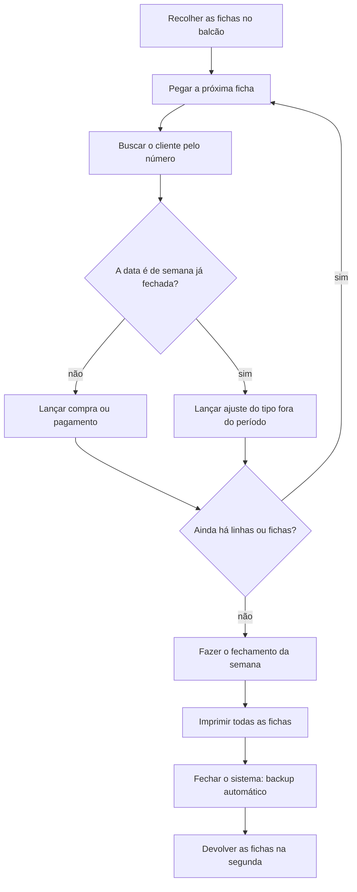
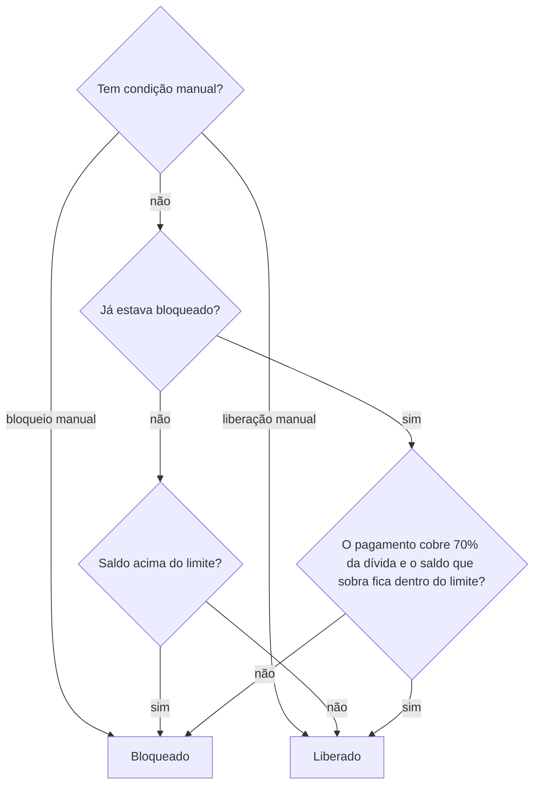
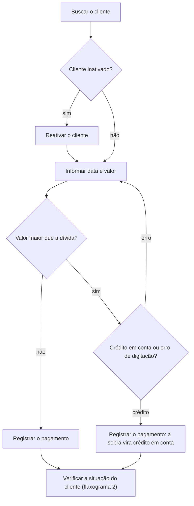
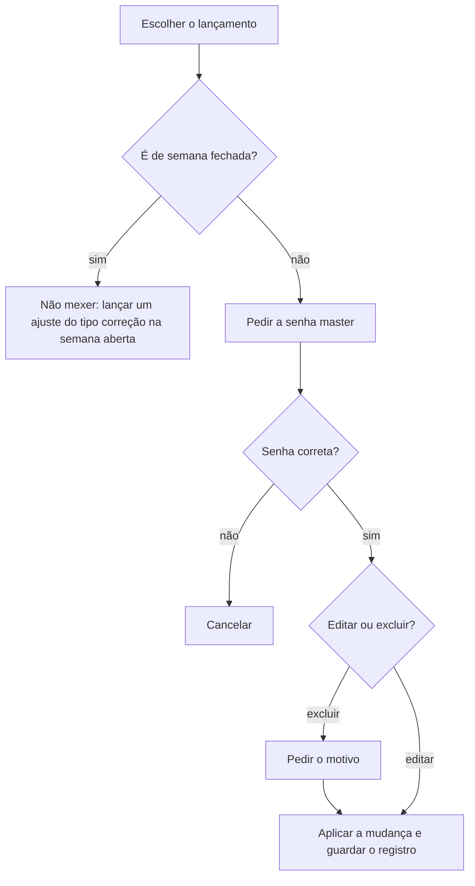
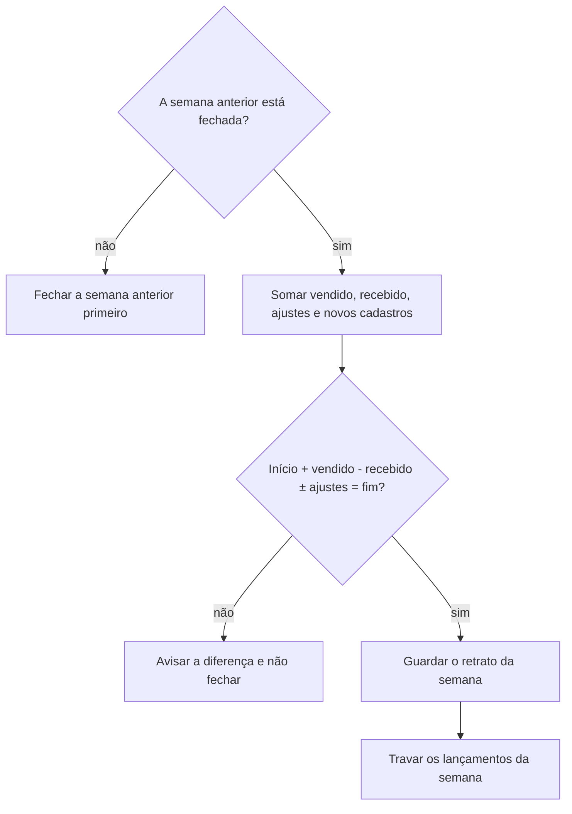

# Fluxogramas

Ligado a: [[Trilha - Caderneta de Fiado]] · [[Caderneta de Fiado - Requisitos]]

> Fluxograma = desenho do passo a passo de um processo. Retângulo é uma ação, losango é uma decisão (com saída "sim" e "não"), seta que volta é uma repetição.

## 1. Fechamento de sábado

Sugerido pelo Mentor e aprovado por mim em 26/11/2026.

**De onde veio cada passo**
- Buscar o cliente pelo número: RF38
- Ajuste do tipo fora do período: RF28 e RN13
- Fechamento da semana: RF27
- Imprimir todas as fichas: RF25
- Backup automático ao fechar: RNF02

## 2. Situação do cliente: bloqueado ou liberado

Sugerido pelo Mentor em 26/11/2026, a partir da RN07, RN08 e RN10. Aprovado por mim em 26/11/2026.

## 3. Lançar um pagamento

Sugerido pelo Mentor em 26/11/2026, a partir do RF10, RF14, RN04 e RN09. Aprovado por mim em 26/11/2026.

## 4. Corrigir um lançamento

Vale para compra, pagamento e ajuste. Sugerido pelo Mentor em 26/11/2026, a partir da RN05, RNF01, RF39 e RF40. Aprovado por mim em 26/11/2026.

## 5. Fazer o fechamento da semana

Sugerido pelo Mentor em 26/11/2026, a partir do RF27, RN06, RN11 e RN12. Aprovado por mim em 26/11/2026. Decidi em 26/11/2026 que, se a conta não bater, o sistema não deixa fechar (RN14).

