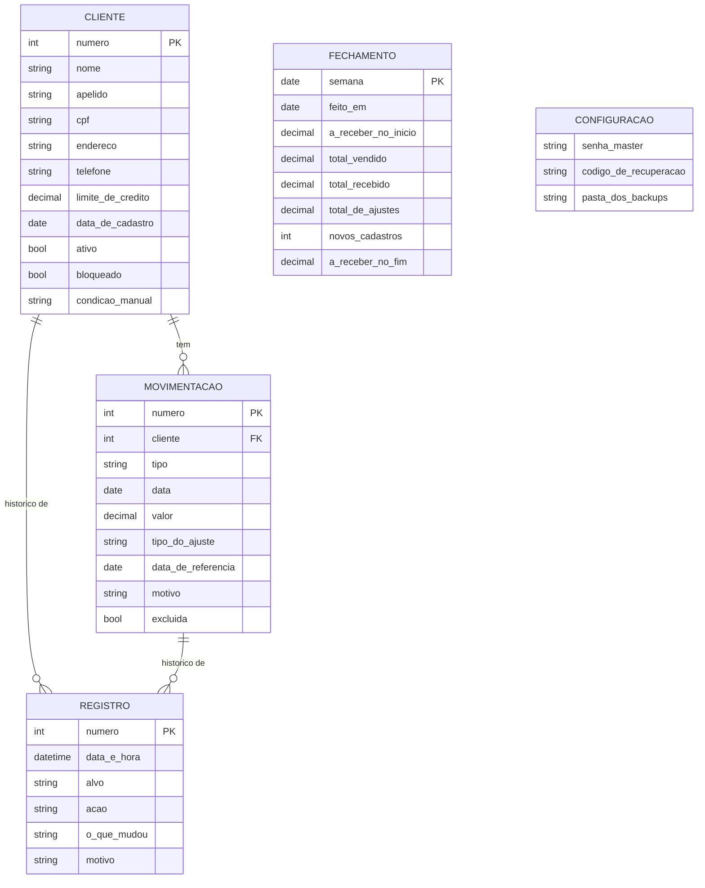

# Modelo de Dados

Ligado a: [[Trilha - Caderneta de Fiado]] · [[Caderneta de Fiado - Requisitos]] · [[Caderneta de Fiado - Fluxogramas]]

> Modelo de dados = o mapa do que o sistema guarda. **Entidade** é um tipo de coisa que o sistema lembra, **atributo** é uma informação sobre ela, **relacionamento** é como as coisas se ligam.

As entidades Cliente, Movimentação, Fechamento e Registro de alterações eu identifiquei em 26/11/2026. A Configuração e os atributos foram sugeridos pelo Mentor, a meu pedido. Conferi e aprovei em 26/11/2026, no chat com o Mentor.

## As três perguntas para escolher um atributo
1. **O que o requisito manda guardar?** Cada atributo tem um RF ou RN por trás.
2. **O que identifica essa coisa sem confusão?** Um número único, nunca o nome.
3. **Isso se guarda ou se calcula?** O que dá para calcular não se guarda, para os dois valores nunca discordarem.

## Desenho

## 1. Cliente
| Atributo | O que guarda | De onde veio |
|---|---|---|
| Número | Identificador único, gerado pelo sistema, nunca reaproveitado | RF37 |
| Nome | Obrigatório | RF01 |
| Apelido, CPF, endereço, telefone | Opcionais | RF01 |
| Limite de crédito | Obrigatório | RF01 |
| Data de cadastro | Quando entrou no sistema | RF27 (novos cadastros da semana) |
| Ativo | Sim ou não | RF04, RF05 |
| Bloqueado | Sim ou não | RN07, RN08 |
| Condição manual | Nenhuma, bloqueio manual ou liberação manual | RN10 |

## 2. Movimentação
Compra, pagamento e ajuste são uma entidade só, separadas pelo tipo.

| Atributo | O que guarda | De onde veio |
|---|---|---|
| Número | Identificador único | pergunta 2 |
| Cliente | De quem é o lançamento (o número do cliente) | RF06, RF10, RF28 |
| Tipo | Compra, pagamento ou ajuste | RF06, RF10, RF28 |
| Data | Dia do lançamento; define a semana | RN11 |
| Valor | No ajuste, pode ser para mais ou para menos | RF06, RF10, RF28 |
| Tipo do ajuste | Correção ou fora do período (só no ajuste) | RF28 |
| Data de referência | Dia real do fato (obrigatória no fora do período) | RF28, RN13 |
| Motivo | Obrigatório no ajuste | RF28 |
| Excluída | Sim ou não: o lançamento excluído fica marcado, não some | RF08, RF12, RF39 (sugestão do Mentor) |

## 3. Fechamento
| Atributo | O que guarda | De onde veio |
|---|---|---|
| Semana | O domingo em que a semana começa; identifica o fechamento | RN11 |
| Feito em | Dia em que o fechamento foi feito | RF27 |
| A receber no início | | RF27 |
| Total vendido | | RF27 |
| Total recebido | | RF27 |
| Total de ajustes | | RN06 |
| Novos cadastros | | RF27 |
| A receber no fim | | RF27 |

O fechamento é a exceção da pergunta 3: os totais dariam para calcular, mas são guardados de propósito. É um **retrato**: tem que mostrar para sempre como a semana estava no dia em que foi fechada.

## 4. Registro de alterações
A trilha de auditoria: quem fez o quê, quando e por quê.

| Atributo | O que guarda | De onde veio |
|---|---|---|
| Número | Identificador único | pergunta 2 |
| Data e hora | Quando aconteceu | RF03, RF09, RF13, RF40 |
| Alvo | O cliente ou a movimentação que foi alterada | RF03, RF09, RF13, RF40 |
| Ação | Edição, exclusão, inativação, reativação, bloqueio manual, desbloqueio manual, retirada da condição manual | RF04, RF05, RF33, RF34, RF35 |
| O que mudou | O valor de antes e o de depois | RF03, RF09, RF13, RF40 |
| Motivo | Obrigatório na exclusão e no bloqueio ou desbloqueio manual | RF08, RF12, RF33, RF34, RF39 |

## 5. Configuração
Uma só para o sistema inteiro.

| Atributo | O que guarda | De onde veio |
|---|---|---|
| Senha master | Guardada embaralhada (hash), nunca a senha em si | RNF01 |
| Código de recuperação | Também embaralhado | RF36 |
| Pasta dos backups | Onde ficam as 7 cópias | RNF02, RNF03 |

Hash = um embaralhamento de mão única: dá para conferir se a senha digitada é a certa, mas não dá para descobrir a senha olhando o que está guardado.

## Relacionamentos
- Um **cliente** tem várias **movimentações**; cada movimentação é de um cliente só.
- Um **cliente** e uma **movimentação** podem ter vários **registros de alterações**.
- O **fechamento** não aponta para as movimentações: ele as encontra pela data, que cai dentro da semana (RN11).

## O que não se guarda, porque se calcula
- Saldo do cliente (RN01)
- Total a receber, exposição, clientes acima do limite, clientes bloqueados, créditos em conta e perdas (RF17 a RF20, RF31, RF32)
- Se a semana de um lançamento está aberta ou fechada: basta ver se existe fechamento para a semana da data
